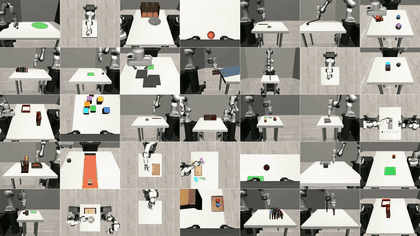
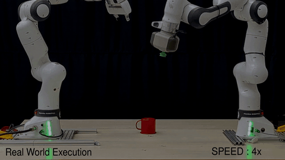

AI Engineer at **Neomanav Robotics**, teaching humanoid robots new skills. IIT Mandi graduate.

---

### 📄 Research

<table>
<tr>
<td width="42%"></td>
<td>

**IMBench: A Benchmark for Intuitive Robotic Manipulation** 
 
*Anurag Maurya, Sukhvansh Jain, et al.*

35 robot tasks that test whether AI models understand everyday physics well enough to actually do things with their hands, like using tools, pushing objects aside, or recovering when something slips.

[Paper](https://arxiv.org/abs/2607.15641) · [Project page](https://imbench.org)

</td>
</tr>
<tr>
<td width="42%"></td>
<td>

**Embodiment-Aware Planning for Heterogeneous Bimanual Manipulation** 
 
*Sukhvansh Jain, Anurag Maurya, Shivam Vats, Narendra Kumar Dhar, Ravi Prakash*

Two robot arms with different simple grippers (a suction cup and a two-finger gripper) working together on tasks neither can do alone. From one human demo, the robot decides which arm does each step and when to hand the object over.

[Paper](https://arxiv.org/abs/2610.23551) · [Project page](https://sukhvansh2004.github.io/Bimanual-Manipulation/) · [Code](https://github.com/Sukhvansh2004/Bimanual-Manipulation)

</td>
</tr>
</table>

---

### 🏆 Highlights

- 🏅 **Director's Gold Medal, IIT Mandi (2026)** – for all-round excellence in the graduating B.Tech batch.
- 🥉 **Bronze medal, Inter IIT Tech Meet 14.0** – a robot that drives around a warehouse on its own, scans shelves, and keeps the stock list up to date. [Code](https://github.com/Sukhvansh2004/WareHouse-Inventory-Management)
- 🥉 **Bronze medal, Inter IIT Tech Meet 12.0** – rebooking airline passengers when flights get changed or cancelled, solved with both regular and quantum computing. [Code](https://github.com/STAC-IITMandi/Mphasis-Foundation-PS-TEAM_59)
- 🚀 **Team Deimos, IIT Mandi (2023 – 2026)** – Joined our [Mars rover team](https://github.com/Team-Deimos-IIT-Mandi) as a software member, then became Software Lead and finally Project Lead. Qualified for the Anatolian Rover Challenge 2026.
- 🔊 **Audio Scene Synthesis** – a model that turns a text description into realistic sound, reaching better results with 10× less training than the original. [Code](https://github.com/Sukhvansh2004/Audio-Scene-Synthesis)

---

### 🛠️ Selected projects

| Project | What it does |
|---|---|
| [Robot Swarm](https://github.com/Sukhvansh2004/Centralized-Intelligence-Robot-Swarm) | Inter IIT Tech Meet 13.0: a team of robots that explore and map an unknown place together, and take jobs given in plain English, like "check the backpack at (10, 20)" |
| [Robosuite ↔ Franka Bridge](https://github.com/Sukhvansh2004/robosuite-franka-ros-bridge) | Lets the same code run on a simulated robot and on two real Franka arms |
| [Moon Mapping](https://github.com/Sukhvansh2004/Moon-Mapping) | Sharpening Chandrayaan-2 images of the Moon with AI (Space Technology Club, IIT Mandi) |
| [Robot Self-Localization](https://github.com/Sukhvansh2004/RTAB-Map-Frosthack-Global-Localization) | A robot that figures out where it is using a 3D camera and LiDAR, no human driving needed |
| [Medical Image Prognosis](https://github.com/Sukhvansh2004/Medical-Image-Prognosis) | Cleans up and aligns brain MRI scans so they can be used to predict disease progress |
| [DocBot](https://github.com/Sukhvansh2004/DocBot-P22-B) | Upload a PDF and ask questions about it in plain language |

---

### 🧰 Tools I use

---

### 📈 Activity

<picture>
  <source media="(prefers-color-scheme: dark)" srcset="https://raw.githubusercontent.com/Sukhvansh2004/Sukhvansh2004/output/github-snake-dark.svg" />
  <source media="(prefers-color-scheme: light)" srcset="https://raw.githubusercontent.com/Sukhvansh2004/Sukhvansh2004/output/github-snake.svg" />
  
</picture>

💼 Since April 2026, most of my work happens on my work account, <a href="https://github.com/sukhvansh-manav">@sukhvansh-manav</a>.

